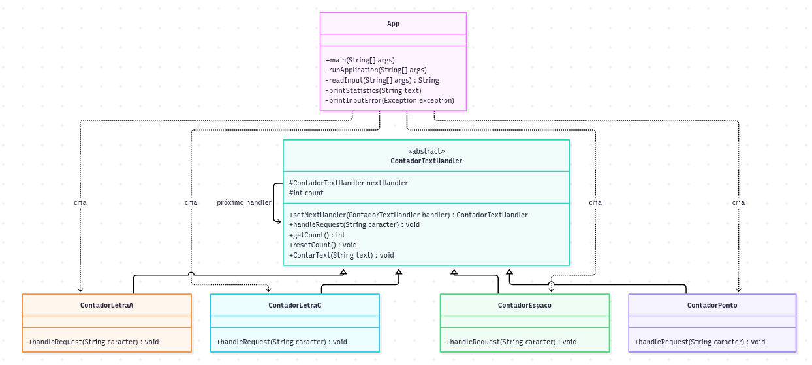

# Contador de texto

Aplicação Java que conta espaços, letras `a`/`A`/`c`/`C` e pontos usando o padrão

**Chain of Responsibility**.

## Diagrama 



## Como funciona

Cada tipo de caractere é tratado por um elo diferente:

```text
ContadorLetraA -> ContadorLetraC -> ContadorEspaco -> ContadorPonto
```

Cada handler incrementa seu próprio contador quando reconhece o caractere. Quando não reconhece, encaminha a solicitação ao próximo elo. Ao final do processamento, `App` exibe a listagem consolidada.

## Execução pelo Shell

Compile os fontes:

```bash
mkdir -p bin
javac -d bin src/*.java
```

Para informar o texto diretamente:

```bash
java -cp bin App "A casa. A casa."
```

Para processar um arquivo UTF-8:

```bash
java -cp bin App --file caminho/para/texto.txt
```

Exemplo de saída:

```text
Contagem final:
Letras A: 4
Letras C: 2
Espaços: 3
Pontos: 2
```

Os comentários Javadoc dos fontes descrevem a responsabilidade de cada handler e podem ser usados para gerar documentação com `javadoc`.
 